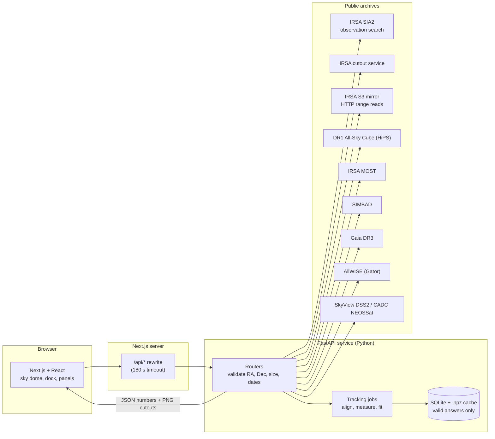

<div align="center">
  <h1>HANOS</h1>
  <p><strong>See the sky change. Real SPHEREx data, in time order.</strong></p>
  <p>An open web tool for exploring NASA SPHEREx observations over time, spotting objects that move or change brightness, and checking the evidence behind every claim.</p>

  <p>
    <a href="https://www.spaceappschallenge.org/2026/challenges/planet-x-and-spherex/"></a>
    <a href="https://www.spaceappschallenge.org/2026/challenges/planet-x-and-spherex/"></a>
    <a href="https://nextjs.org"></a>
    <a href="https://react.dev"></a>
    <a href="https://www.typescriptlang.org"></a>
    <a href="https://fastapi.tiangolo.com"></a>
    <a href="#licence"></a>
  </p>

  <p>
    <strong>Live site: <a href="https://hanos.surf">hanos.surf</a></strong> &middot; Addis Ababa local event, 14 to 15 November 2026
  </p>

  <p>
    <a href="#overview">Overview</a> &middot;
    <a href="#features">Features</a> &middot;
    <a href="#quick-start">Quick start</a> &middot;
    <a href="#architecture">Architecture</a> &middot;
    <a href="#api-reference">API</a> &middot;
    <a href="#science-rules">Science rules</a> &middot;
    <a href="#credits-and-acknowledgements">Credits</a>
  </p>
</div>

> **Working name:** the documents in `docs/` sometimes call the project *COSMIC PULSE*. HANOS and COSMIC PULSE are the same project.

---

## Table of contents

1. [Overview](#overview)
2. [Why it exists](#why-it-exists)
3. [Principles: what "real data only" means here](#principles-what-real-data-only-means-here)
4. [Features](#features)
5. [A tour of the explorer](#a-tour-of-the-explorer)
6. [Cosmic Sound](#cosmic-sound)
7. [The five required test targets](#the-five-required-test-targets)
8. [Quick start](#quick-start)
9. [Configuration](#configuration)
10. [Architecture](#architecture)
11. [API reference](#api-reference)
12. [Scientific rules](#scientific-rules)
13. [Accessibility and design](#accessibility-and-design)
14. [Performance and reliability](#performance-and-reliability)
15. [Testing and quality](#testing-and-quality)
16. [Repository layout](#repository-layout)
17. [Scripts reference](#scripts-reference)
18. [Documentation index](#documentation-index)
19. [Roadmap and status](#roadmap-and-status)
20. [Known limitations](#known-limitations)
21. [Troubleshooting](#troubleshooting)
22. [Team](#team)
23. [Contributing](#contributing)
24. [Licence](#licence)
25. [Credits and acknowledgements](#credits-and-acknowledgements)

---

## Overview

**HANOS** is our entry to the **2026 NASA Space Apps Challenge, "Planet X and SPHEREx"**.

[SPHEREx](https://science.nasa.gov/mission/spherex/) is a NASA space observatory that maps the whole sky in **102 infrared wavelengths**, about every six months. Because it keeps returning to the same patches of sky, its archive can show how things **change over time**. The challenge asks for a public web tool that makes those observations easy for anyone to explore and compare.

HANOS lets you:

- **Pick a place or an object** on an interactive 3D sky dome, or type a name or coordinates.
- **Retrieve real SPHEREx observations** of that place from the NASA/IPAC Infrared Science Archive (IRSA), time ordered.
- **Play them as a time-lapse**, with the month and year shown and the date marker moving along a timeline.
- **Compare frames** (blink, side by side, difference), always with a warning when the two frames see different wavelengths.
- **Measure change**: motion and brightness, from the real pixels, with an **Evidence Card** that says what was checked and what was not.
- **Read the infrared colours** of an object across the 102 channels, with error bars.
- **Listen to a region.** Select a constellation, press Play, and a vertical line sweeps across it while each star or each infrared channel becomes a note (see [Cosmic Sound](#cosmic-sound)).
- **Share a view** as a link or a downloadable card with a QR code.

> HANOS never claims a discovery. The strongest statement it makes is *"observed change"* or *"candidate, needs verification"*.

---

## Why it exists

Planet X, a hypothetical distant planet, is **unconfirmed**. Looking for it, or for any faint object that moves or varies, means comparing images taken at different times. The raw SPHEREx archive is rich but hard to approach: files are large, each image carries a different wavelength, pixels have many quality flags, and the right comparison depends on details most visitors do not know.

HANOS does that careful work on the server and shows the result in plain language, while keeping the scientific details one click away for people who want them.

Two audiences are served on purpose:

| Reader | What they get |
|---|---|
| **Curious public** | A sky to explore, a time-lapse with dates, short sentences such as *"It moves 10.09 arcsec per year"*, and a note on how sure the tool is. |
| **Scientists and students** | Per-frame wavelength, release, detector and flag summary under every image, measured positions and fluxes with errors, the exact method and the checks performed. |

---

## Principles: what "real data only" means here

These rules are enforced in the code and in review. They matter more than any single feature.

1. **Never fabricate data.** No invented observations, dates, spectra or detections. There is no mock, sample or simulated data anywhere, not even for UI development. If an archive is slow, the tool shows progress and falls back to the **last real stored result**, labelled as such.
2. **Illustrations are labelled.** The landing page drawings, the device-frame picture and the orbit artwork are decorative. They are not mission imagery and not evidence.
3. **Claim levels are fixed.** *Observed change* → *candidate* ("possible mover or variable; needs verification"). The word "discovery" is never used. A difference between two images is not proof: wavelength, beam shape, alignment and detector artefacts can all produce one.
4. **Failures are loud.** Archive errors are retried with backoff and then raised. They are never swallowed and never cached. (An earlier version cached an empty list after a timeout, so every target looked like it had no observations. That bug is the reason for this rule.)
5. **Honest absence.** When a target is too faint to measure, the answer is *"not reliably detected"*, not a made-up number.
6. **Sound only from real data.** Cosmic Sound plays catalogue stars or a real SPHEREx spectrum, labels which, and never plays a value that was not measured (see [Cosmic Sound](#cosmic-sound)).

---

## Features

Status is stated plainly: **Done** means it works against the real archives today.

### Explorer

| Feature | What it does | Status |
|---|---|---|
| **3D sky dome** | WebGL dome (three.js) with 5,044 catalogue stars, the 88 constellations and their IAU boundaries, labels, horizon and grid. Drag to look around, zoom, fly to a target. | Done |
| **Selection** | Click a star or a constellation region: a ring (star) or dashed outline (region), with Play, Info and Share actions. Play on a region opens Cosmic Sound. | Done |
| **Search** | Type a name (resolved at run time by SIMBAD) or coordinates (decimal or sexagesimal). | Done |
| **Real observation retrieval** | Searches IRSA (SIA2) for every SPHEREx frame covering the position, from DR1 and QR3, with true per-frame wavelength, date, detector and flag counts. | Done |
| **Time-lapse dock** (bottom left) | The selected object over time: auto or manual stepping, month and year, a timeline whose dot moves with the date of the current frame, detector chips D1 to D6, the measured position circled and the predicted position marked. | Done |
| **Brightness and 102-channel colours** | A plain-language "infrared colours" strip: one dot per exposure, wavelength left to right, flux up, older to newer from dim to bright. | Done |
| **Compare** | Blink (default 500 ms, never faster than 3 flashes per second, with a step-through button), split view, and A-B, A+B, B-A on frames aligned on the sky. A "best pair" button picks two frames of the same wavelength that are furthest apart in time. | Done |
| **Change** | Motion fit and brightness test on real single exposures, with an Evidence Card and a measurement table. | Done |
| **Spectra** | The 102-channel spectrum from the DR1 All-Sky Cube (labelled as stacked, no time information) or one point per real exposure; flux versus wavelength with error bars and the well-known spectral features marked; a keyboard-reachable point-by-point readout. | Done |
| **Per-detector stack** | Adds up frames of one detector only (never across detectors), optionally following a known proper motion (shift and add). | Done |
| **Overlays** | Gaia DR3 stars (moved to the observation date) and AllWISE sources drawn on the frames. | Done |
| **Targets panel** | One button per required test target: resolve it, check the archive, open it in the dock. | Done |
| **Moving objects** | Real SPHEREx frames that contain a named asteroid, comet or planet, from IRSA MOST (JPL Horizons predictions). | Done (search and fly-to) |
| **Cosmic Sound** | Pop-up for a region: the region and a left-to-right scan line, a pitch graph, slow playback, two data sources (catalogue stars, real SPHEREx spectrum), MIDI, WAV and note-table downloads. See [Cosmic Sound](#cosmic-sound). | Done |
| **Share** | Copy a link, copy an embed snippet, or open a downloadable PNG share card with a QR code. | Done |
| **Context layers** | Optional DSS2 optical image and NEOSSat/CADC context. Clearly labelled as other missions, never SPHEREx. | Done (optional) |

### Landing site

| Feature | Status |
|---|---|
| Illustrated landing page at `/` and the challenge page at `/challenge`, ported from the team's own design (github.com/melat320/hanossurf), with a day and night mode, a pinned team story and page wipe. Server-rendered, no script needed to read it. | Done |

### Not built yet

| Feature | Status |
|---|---|
| Sonification of **change over time** (Cosmic Sound plays positions, brightness and spectra today, not time series) | Planned |
| **Discovery Room** (citizen classification) | Planned (COULD priority). |
| Advanced anomaly detection | Planned (COULD priority). |

---

## A tour of the explorer

1. Open **`/explore`**. The dome starts at a wide field of view.
2. **Find something.** Use the **Search** icon (top right), click a star or constellation on the dome, or press **Open** on a test target in the **Targets** panel.
3. The **time-lapse dock** opens at the bottom left with the object's name, position and a short description (for example *"red dwarf star, 6.0 light years away"*).
4. Real frames load. A **measuring** counter shows progress; the first frames can be played at once.
5. Press **Auto** or step through with the arrows. The **dot on the month strip moves with the date** of the frame shown.
6. Choose a different infrared band with **D1 to D6**. Frames of different bands are never mixed.
7. Read the **plain sentence** under the image (for example *"It moves 10.09 arcsec per year. Measured over 1.02 years from 59 frames. It matches the known motion."*) and open **Details for scientists** for the numbers.
8. Use **Compare**, **Change**, **Spectra** and **Overlays** from the icon bar for deeper looks.
9. Use **Share** to copy a link or save the share card.

### Share links

The explorer keeps its state in the address bar, so any view can be linked:

| Parameter | Meaning | Example |
|---|---|---|
| `ra`, `dec` | View centre in degrees (J2000). | `ra=269.45&dec=4.77` |
| `fov` | Field of view in degrees. | `fov=5.0` |
| `sel` | A selection: `star:<id>`, `region:<abbr>`, or `object:<name>`. | `sel=object:WISE%200855-0714` |
| `target` | A name to resolve through SIMBAD and open in the dock. | `target=Barnard's%20Star` |
| `embed=1` | Embedded mode for an `<iframe>`. | `embed=1` |

```
https://hanos.surf/explore?target=WISE%200855-0714
```

---

## Cosmic Sound

Select a **constellation region** on the dome and press **Play** in the selection capsule. A pop-up opens. Nothing sounds until you press Play inside it, because browsers only allow audio after a click.

1. The pop-up draws the **region**: its IAU boundary and its catalogue stars, with right ascension growing to the right.
2. A **vertical scan line** moves left to right. Each star sounds when the line reaches it, and turns blue.
3. A **pitch graph** at the bottom shows every note (time across, pitch up) with its own playhead.
4. It plays **slowly** (about 40 seconds for a region). Pause, Stop, a speed setting (Slow, Medium, Fast: the notes move in time, the pitch never changes) and a **volume limit** are always available.

| Mode | Data | Mapping |
|---|---|---|
| **Stars** (default) | Our catalogue of 5,044 stars (Hipparcos and Yale). **Not SPHEREx data**, and the pop-up says so. | Left to right: right ascension (the scan starts after the largest gap, so the 0/360 seam never cuts a region). Height: declination, onto a C Lydian scale from C3 to C5. Loudness: brightness. One beat per star, 36 beats per minute. Up to the 140 brightest stars sound; the rest are listed as silent, with the reason. |
| **SPHEREx spectrum** | A real **DR1 All-Sky Cube** spectrum (102 channels, stacked, no time information) read at a few catalogue positions in the region. The position with the most usable channels is used (a fixed rule, not a claim that it is the most important). | Left to right: channel order (not observing time). Height: wavelength, short wavelength high (0.75 to 5 micron, log scale). Loudness: surface brightness, positive valid channels only. Blank, masked, missing and non-positive channels are rests; nothing is filled in. Bright channels get quiet strings an octave lower, labelled as composition. 30 beats per minute. |

Under the picture: a **note table** (every star or channel, its pitch, frequency, loudness and the reason, including every rest and skipped star), a **How the data becomes sound** key, and downloads: **MIDI** (with MIDI Tuning Standard messages for the exact tuning), **WAV** (mono, 16-bit, 22,050 Hz) and the **note table as CSV**.

Tuning is **just intonation rooted on C** (the ratio table is in `src/lib/sonify/tuning.ts`). A plain MIDI player ignores the tuning messages and plays equal temperament; the WAV and the note table carry the exact frequencies. The method is specified in [`docs/HANOS_METHOD_MASTERPROMPT.md`](docs/HANOS_METHOD_MASTERPROMPT.md); the display plan is in [`docs/03-design/prompts/10-sonification-popup.md`](docs/03-design/prompts/10-sonification-popup.md).

What it does not do: it does not sonify change over time, it has no deep-sky object voice (we have no such catalogue), and the first spectrum read for a region can take a minute (it is cached afterwards). Sound does not travel through space: the sound is a chosen mapping of data, not a recording, and the pop-up says so.

---

## The five required test targets

The challenge names five objects for testing. **Only WISE 0855's coordinates came from NASA**; the other four are resolved at run time through SIMBAD and moved to the observation date with their real proper motion. No coordinate is typed in from memory.

| Target | What it is | Why it is a good test |
|---|---|---|
| **Barnard's Star** | Red dwarf, 6.0 light years away | The fastest apparent motion in the sky, about 10.4 arcsec per year. A very bright star: its core saturates, so fluxes are lower limits. |
| **Epsilon Indi B** | Brown dwarf in a pair | A faint, nearby moving source. |
| **WISE 0855** | One of the coldest known brown dwarfs | Moves about 8 arcsec per year and is faint at most SPHEREx bands. NASA's published position is a mean position at about epoch 2010.45; HANOS derives that epoch from SIMBAD's proper motion and propagates the position instead of using NASA's number directly. |
| **RW Aurigae** | Young variable star | Brightness changes between epochs. |
| **R Draconis** | Pulsating red giant | Brightness changes over months. |

### What has been verified so far

- **Barnard's Star, detector 4:** 59 real frames from DR1 and QR3 (August 2025 to September 2026). The fitted motion is **10.09 arcsec per year (31 sigma)** against the known 10.39 arcsec per year. The brightness test is reported as *not tested* because the core saturates.
- **WISE 0855:** single frames give only marginal detections (for example, signal-to-noise of at least 5 in 14 of 48 frames on detector 5). HANOS reports *"not reliably detected"* rather than fitting a motion to noise, and points to the per-detector stack.
- **Resolution check:** WISE 0855's NASA position agrees with the propagated SIMBAD position to 0.19 arcsec at the derived epoch.

The full, regenerated table lives in [`docs/01-project/test-matrix.md`](docs/01-project/test-matrix.md). It is built from real results only:

```bash
python scripts/prewarm_targets.py            # runs the real pipeline for the five targets and caches it
python scripts/build_test_matrix.py          # turns the stored results into the matrix
```

> **Status note:** the committed matrix can be incomplete until the pre-compute has finished for all five targets (it takes a long time because every frame is downloaded). Empty cells mean "not run yet", never "no data".

---

## Quick start

### Prerequisites

| Tool | Version | Why |
|---|---|---|
| Node.js | 22 (see `.nvmrc`) | Next.js frontend |
| npm | bundled with Node | Dependencies and scripts |
| Python | 3.11 or newer (tested with 3.13) | FITS processing API |
| [uv](https://docs.astral.sh/uv/) | recent | Creates the Python environment (any venv tool works) |
| Internet access | | IRSA, SIMBAD, Gaia, SkyView and the S3 mirror are queried live |

### 1. Get the code

```bash
git clone <repository-url> hanos
cd hanos
nvm use        # optional: selects Node 22 from .nvmrc
```

### 2. Install the frontend

```bash
npm ci
cp .env.example .env.local     # see Configuration
```

### 3. Install the backend

<details open>
<summary><strong>Windows (PowerShell)</strong></summary>

```powershell
uv venv services/api/.venv
uv pip install -r services/api/requirements.txt --python services/api/.venv
```
</details>

<details>
<summary><strong>macOS and Linux</strong></summary>

```bash
uv venv services/api/.venv
uv pip install -r services/api/requirements.txt --python services/api/.venv
```
</details>

### 4. Run everything

```bash
npm run dev:all      # FastAPI on http://127.0.0.1:8000 and Next.js on http://localhost:3000
```

Open <http://localhost:3000> for the landing page and <http://localhost:3000/explore> for the explorer.

Check that the archives are reachable (this makes real requests, so it takes a few seconds):

```bash
curl http://127.0.0.1:8000/api/health
```

### Running the two parts separately

```bash
# Backend (from the repository root)
PYTHONPATH=. services/api/.venv/bin/python -m uvicorn services.api.main:app --host 127.0.0.1 --port 8000
#   Windows PowerShell:
#   $env:PYTHONPATH="."
#   services\api\.venv\Scripts\python.exe -m uvicorn services.api.main:app --host 127.0.0.1 --port 8000

# Frontend
npm run dev
```

> **Windows tip:** for anything other than quick development, start the API **without `--reload`**. The reloader can leave an orphan process holding port 8000. `npm run dev:all` uses `--reload` for convenience.

### Production build

```bash
npm run build
npm run start        # serves the production build; /api/* is forwarded to API_BASE_URL
```

The live site (`https://hanos.surf`) is the website on **Vercel**, with the science API as a Docker service on **Render**
(`render.yaml`). Vercel forwards `/api/*` to Render, so the browser only ever talks to one address. The whole procedure,
settings, rollback and the first-deployment checklist are in [docs/DEPLOYMENT.md](docs/DEPLOYMENT.md).

### Make the demo independent of the network

The live demo must not depend on network speed. Pre-compute the five targets once:

```bash
PYTHONPATH=. services/api/.venv/bin/python scripts/prewarm_targets.py
```

This downloads and measures real frames for every required target and detector and stores them in `services/api/cache/`. Afterwards the explorer answers from disk. Pass target names and `--detectors 4,1,2,3,5,6` to limit the work.

---

## Configuration

Copy `.env.example` to `.env.local`. Nothing secret is needed: all archives used are public.

| Variable | Default | Purpose |
|---|---|---|
| `NEXT_PUBLIC_SITE_URL` | `https://hanos.surf` | Public base address used in share links, QR codes and canonical URLs. Only change it for another domain. |
| `API_BASE_URL` | `http://127.0.0.1:8000` | Where `/api/*` is forwarded (a rewrite in `next.config.ts`). On Vercel it is **required** and is the address of the Render service. |

The science API reads its own variables (`HANOS_ENV`, `HANOS_CACHE_DIR`, `HANOS_SQLITE_WAL`, `HANOS_CORS_ORIGINS`, rate limits, `HANOS_MAX_JOBS`, `HANOS_LOG_LEVEL`); they are listed in [docs/DEPLOYMENT.md](docs/DEPLOYMENT.md#settings-reference) and `.env.example`. `npm run dev:all` starts it with `HANOS_ENV=development`.

Other settings worth knowing:

| Where | Setting | Why |
|---|---|---|
| `next.config.ts` | `experimental.proxyTimeout: 180000` | Next.js cuts proxied requests off after 30 s by default. The first all-sky cube tile or a stack can take longer. |
| `next.config.ts` | `headers()` | Landing assets that never change under the same name are cached for a year. |
| `services/api/config.py` | archive URLs and cache paths | Collection names are read from IRSA at run time, not hard-coded. |

---

## Architecture



### Data flow in one sentence

The browser asks the API for a position; the API validates it, finds the SPHEREx frames that cover it (**SIA2**), downloads small cutouts, reads the wavelength and flags from each real file, aligns the frames on a common sky grid, measures them, and returns **JSON (numbers and metadata) plus PNG (server-rendered cutouts with a documented stretch)** that React draws.

### Why this shape

| Decision | Reason |
|---|---|
| **FITS processing stays in Python** (Astropy, NumPy, reproject, hpgeom), not Node. | The scientific libraries and file handling are mature there. |
| **Observation search uses SIA2, not TAP.** | TAP took 20 s to more than 2 minutes in testing, and a swallowed timeout once produced a false "no observations" result. |
| **Per-frame metadata costs about 70 KB, not 65 MB.** | Only the first 64 KB (headers) and last 8 KB (the wavelength lookup table) of each file are range-read from the anonymous S3 mirror. |
| **Cutouts are compacted.** | Each cutout is about 4 MB because it carries a 441-zone ePSF table. We keep the image, flags, variance, zodi, a per-pixel wavelength map, the header and the one ePSF zone that applies: about 45 KB. |
| **Tracking is a background job that is polled.** | Downloading and measuring dozens of frames takes a minute; the UI shows live progress and can play the first frames immediately. |
| **One cache, valid answers only.** | SQLite (WAL mode) plus compact `.npz` cutouts. A schema version drops results produced by older code. |

### Frontend structure

- **Next.js 16 App Router**, React 19, TypeScript (strict), Tailwind CSS 4.
- **Route groups:** `(landing)` for `/` and `/challenge`, `(app)` for `/explore`. They have separate layouts; the root layout stays minimal.
- **Server Components by default;** `"use client"` only for interactivity (sky dome, dock, panels, landing behaviour).
- The sky dome reads pre-packed binary star and boundary data (`public/data/`) and runs its picking in a Web Worker (`public/workers/sky-worker.js`).

### Backend structure

```
services/api/
├── main.py            FastAPI app, routers, CORS, error handling
├── config.py          archive URLs, cache paths
├── cache.py           SQLite (WAL) + .npz cutout cache, schema versioning
├── tracking.py        background jobs: frames, positions, fluxes, motion and brightness tests, Evidence Card
├── routers/           one module per endpoint family
├── clients/           IRSA SIA2, cutouts, S3 range reads, All-Sky Cube, SIMBAD, Gaia, AllWISE, MOST, context
├── astro/             FLAGS masks, ePSF, WCS helpers, photometry, units, rendering, coordinates, spectra
└── tests/             offline tests on real saved bytes, plus live tests
```

---

## API reference

Interactive details are in [`services/api/README.md`](services/api/README.md). From the browser everything is under `/api/*` (Next.js forwards to the API).

| Endpoint | What it returns |
|---|---|
| `GET /api/health` | Live probes of every archive and cache statistics. Nothing is reported "verified" without a request. |
| `GET /api/releases` | SPHEREx collections discovered from IRSA, release labels, DOIs, the required acknowledgement text and the release timeline. |
| `GET /api/resolve?name=` | Coordinates and proper motion from SIMBAD (or parsed typed coordinates), propagated to an epoch. |
| `GET /api/observations?ra&dec&radius&detector&deep` | Real SPHEREx frames covering the position, time ordered, each with true wavelength, date, pixel position and flag counts. |
| `GET /api/track?ra&dec&size&detector&pmra&pmdec&epoch&name` | Background job. Poll until `status` is `done`: per-frame list, motion fit, brightness test, light curve, Evidence Card. |
| `GET /api/frame.png?url&ra&dec&size&invert` | One real frame on the common sky grid (north up, east left) with a documented asinh stretch. |
| `GET /api/spectrum?ra&dec&source=allsky\|exposures` | The 102-channel stacked spectrum, or one point per real exposure. |
| `GET /api/stack?detector&...` | Per-detector stack over a time window, optionally following a proper motion. |
| `GET /api/difference?a&b&...` | A-B, B-A or A+B of two aligned frames, with a wavelength-match warning. |
| `GET /api/overlays?ra&dec&size&epoch` | Gaia DR3 (proper motion applied) and AllWISE sources with pixel positions on the frame grid. |
| `GET /api/detectors?ra&dec` | Which of the six detector arrays have frames at the position. |
| `GET /api/moving?name=` | Real SPHEREx frames that contain a named solar-system object (IRSA MOST). |
| `GET /api/context/dss.png`, `/dss`, `/neossat`, `/ssois` | Optional context from other missions. Never SPHEREx data. |

### Example

```bash
# Where is Barnard's Star at the start of 2026, with its real proper motion?
curl "http://127.0.0.1:8000/api/resolve?name=Barnard%27s%20star&epoch=2026"

# Real SPHEREx frames covering it, detector 4 only
curl "http://127.0.0.1:8000/api/observations?ra=269.4463&dec=4.7682&radius=0.05&detector=4"

# Start (or join) the measurement job, then poll the same URL until status is "done"
curl "http://127.0.0.1:8000/api/track?ra=269.4463&dec=4.7682&size=0.1&detector=4&pmra=-801.551&pmdec=10362.394&epoch=2026&name=Barnard"
```

### Errors

| HTTP status | Meaning |
|---|---|
| `400` | Invalid input (for example Declination outside −90 to +90). |
| `404` | Nothing matched (for example an unknown solar-system object). |
| `503` | An archive did not answer after retries. The message says so; nothing was cached. The UI shows it and retries. |

---

## Scientific rules

These come from the research briefings in `docs/02-research/data-briefings/` and are non-negotiable. Where a briefing corrects the project reference, the briefing wins.

### Data

- **Releases.** Prefer **DR1 + QR3**, which share one calibration across Surveys 1 to 4 and form a single time series. **QR2 is retired** and left out of the main queries. Collection names are read from IRSA at run time. The release label is part of every cache key and every API response.
- **Co-added products cannot show motion or brightness change.** The mosaic cube, HiPS and the All-Sky Cube are stacked: use them for spectra only, and say so in the UI. Time-domain features use single-exposure cutouts.
- **Time and wavelength are entangled.** SPHEREx observes a different wavelength at different times. Default to wavelength-matched frames and compare same-band images across dates. The brightness test only compares frames within 2 percent in wavelength.
- **Stacking is per detector.** Never co-add across the six detector arrays or across disparate bands.

| Detector | Wavelength range |
|---|---|
| 1 | 0.75 to 1.09 µm |
| 2 | 1.10 to 1.62 µm |
| 3 | 1.63 to 2.41 µm |
| 4 | 2.42 to 3.82 µm |
| 5 | 3.83 to 4.41 µm |
| 6 | 4.42 to 5.00 µm |

### Pixels and units

- **FLAGS.** Bit 21 means **SOURCE**, not "good pixel", and is never masked. Masks are built from the bad-pixel bits whose names are read from each file's header. Photometry uses a strict mask; the centroid and viewer use a relaxed mask so saturated stars can still be located (their flux is then a **lower limit**).
- **PSF.** Both the legacy PSF layer and the `EPSF` table (version 7 and later) are accepted. Zone counts are never hard-coded. The full 441-zone table is pruned to the single applicable zone.
- **ZODI** is not subtracted from the IMAGE layer. Headers are checked first and it is never subtracted twice. (In the All-Sky Cube it is already subtracted.)
- **Units.** Flux is converted from MJy/sr to µJy using the pixel solid angle: `µJy = MJy/sr × arcsec² × 23.5045`. Always compare objects in µJy. The native pixel scale is **6.15 arcsec per pixel**.
- **Indexing.** FITS extension names and header keywords are used, never fixed pixel numbers. 0- and 1-based pixel indexing is covered by a unit test.

### Positions

- Gaia DR3 positions are propagated from the catalogue epoch **2016.0** to the observation date.
- Each frame's measured centroid is compared with the proper-motion prediction and corrected by the median shift of Gaia reference stars; a weighted straight line is then fitted.
- A target needs a signal-to-noise of at least 5 in at least 8 frames and at least half of the usable frames to get a motion fit. Peaks that do not follow a well-known fast motion are reported as *not reliably detected*.

### Claims and the Evidence Card

| Level | Meaning |
|---|---|
| *no significant change* | Nothing measured above the thresholds. |
| *target not reliably detected* | The object is too faint, or the peaks found do not follow its known motion. |
| *observed change* | A motion or brightness change was measured. It is **not** a discovery. |
| *candidate* | "Possible mover or variable; needs verification." |

Every highlighted object gets an **Evidence Card** listing the checks performed (Gaia reference-star alignment, bad-pixel masking, same-detector comparison) and the reminder that *differences between images are not proof of an astrophysical change*.

### Data-honesty bar

Under every image: **release** (DR1 or QR3), **date**, **detector**, **wavelength**, **percent of pixels masked**, and the line *"Real SPHEREx data, NASA/IPAC IRSA. Background removed, asinh stretch."*

### Sound

Cosmic Sound follows these rules, all implemented: sound comes only from real data (catalogue stars or a real SPHEREx spectrum, each labelled); the mapping is shown in the pop-up; the page states that sound does not travel through space; every audio view has a text equivalent (the note table), a volume limit, a stop button and a visual cursor (the scan line); audio starts only after a user gesture. Missing, masked and blank channels stay silent and are never interpolated.

### Photosensitivity

Blinking is capped at **3 flashes per second** by default (500 ms), with a step-through mode, and blinking is **off until the user starts it**. Reduced-motion preferences are honoured everywhere.

---

## Accessibility and design

### Explorer (`/explore`)

- **Everything is 9 px, regular weight** (a team decision). To compensate, the UI uses generous letter-spacing and line height, high-contrast colours, hit targets of at least 24 × 24 px, and never disables browser zoom. Hierarchy comes from colour, uppercase, spacing, rules and position, not size or weight.
- **Three colours:** blue `#1F48FF` (accent: primary actions, focus, active state), cream `#F5F3ED` (page, text on dark), ink `#111111` (text, panels). Blue text on ink is avoided because it fails contrast at small sizes. Image data uses a colour-blind-safe scale inside the plot and image components.
- Keyboard reachable controls with visible focus, semantic HTML, units always shown, and a text equivalent for every plot (for example, the spectrum's point-by-point readout).

### Landing site (`/`, `/challenge`)

The landing site follows the team's own design and keeps its palette, type and day/night modes. Reduced motion removes drift, parallax and transforms; the navigation collapses into a menu below 768 px; the page works without JavaScript for reading.

---

## Performance and reliability

| Topic | What is done |
|---|---|
| **Demo independence** | `scripts/prewarm_targets.py` caches real results for the five targets, so the live demo does not depend on network speed. |
| **Retries** | Timeouts, connection errors, HTTP 429/5xx and HTML error pages served with status 200 are retried with exponential backoff and jitter. |
| **No false empties** | Failures are raised and never cached. A stored real result is used as the fallback when an archive is slow, and the response says so. |
| **Small queries** | Searches use arcminute radii. Frame metadata costs about 70 KB per file. |
| **SQLite in WAL mode** | The pre-compute script and the API can use the cache at the same time without freezing requests. |
| **AllWISE via Gator** | The same catalogue as TAP, in about 3 s instead of more than 100 s. |
| **Landing page** | Server-rendered markup, fonts preloaded, behaviour loaded as a separate chunk after first paint, long-lived caching for unchanging assets. On an unthrottled local production build, first paint was about 100 ms. Treat this as indicative, not a benchmark. |

---

## Testing and quality

Run these before every pull request. CI runs the first three on every push and pull request.

```bash
npm run lint
npm run typecheck
npm run build
npm test            # sonification: mapping, tuning, MIDI, WAV, note table
```

Backend tests (from the repository root):

```bash
# Offline: uses real bytes saved in services/api/tests/fixtures
PYTHONPATH=. services/api/.venv/bin/python -m pytest -c services/api/pytest.ini services/api/tests -m "not live"

# Live: also calls the public archives
PYTHONPATH=. services/api/.venv/bin/python -m pytest -c services/api/pytest.ini services/api/tests -m live
```

What the tests cover: FLAGS masking (bit 21 is never masked), header-driven bit names, cutout-to-original pixel mapping with real numbers, nearest ePSF zone for any grid size, the flux unit constant against Astropy, proper-motion propagation, coordinate parsing and bounds, HEALPix tile lookup, centroiding of clean and saturated stars, that empty sky is not reported as a detection, claim gating (peaks that do not follow a known motion are not "the target"), and parsing of IRSA responses.

Conventions: Conventional Commits, short-lived branches, small pull requests, TypeScript strict, no `any` without a comment, Server Components by default.

---

## Repository layout

```
.
├── .github/                 CI workflow, issue and pull request templates
├── docs/                    Project documentation (start at docs/README.md)
│   ├── 00-program/          Event programme and deadlines
│   ├── 01-project/          Project reference, data credits, test matrix
│   ├── 02-research/         Data briefings, source extracts, link review
│   └── 03-design/           Design specs, prompts, visual assets
├── public/
│   ├── data/                Packed star, constellation and boundary data for the dome
│   ├── landing/             Landing fonts, team portraits, images, vendored Lenis, licences
│   ├── fonts/               Font for the share card
│   ├── share/               Share card textures
│   └── workers/             Web Worker for sky-dome picking
├── scripts/                 Data preparation, pre-compute, checks (see Scripts reference)
├── services/api/            FastAPI science service (see its README)
├── src/
│   ├── app/                 Routes, layouts, global styles
│   │   ├── (landing)/       / and /challenge
│   │   └── (app)/           /explore
│   ├── components/
│   │   ├── explore/         Sky dome, dock, toolbar, panels, share dialog
│   │   └── landing/         Landing page sections
│   ├── config/              Constants (for example the team list)
│   ├── lib/
│   │   ├── astro/           Coordinates, star index, preloading
│   │   ├── explore/         Target resolution
│   │   ├── landing/         Landing behaviour (scroll story, reveal, theme, wipe)
│   │   ├── sonify/          Cosmic Sound: mapping, tuning, MIDI, WAV, synth, note table, tests
│   │   └── share/           Share card drawing, QR code, share URLs
│   └── types/               Shared types
├── AGENTS.md                Notes for AI coding agents and the design system
├── CONTRIBUTING.md
└── *.config.*               Next, ESLint, TypeScript configuration
```

Import from `src/` with the `@/` alias, for example `import { x } from "@/lib/x"`.

---

## Scripts reference

### npm scripts

| Script | Purpose |
|---|---|
| `npm run dev` | Next.js development server on port 3000 |
| `npm run dev:all` | FastAPI (port 8000, auto-reload) and Next.js together |
| `npm run build` | Production build |
| `npm run start` | Serve the production build |
| `npm run lint` | ESLint |
| `npm run typecheck` | TypeScript check |
| `npm test` | Sonification tests (Node's built-in runner, no extra dependency) |

### Python and Node scripts in `scripts/`

| Script | Purpose |
|---|---|
| `prewarm_targets.py` | Runs the real pipeline for the five targets and fills the cache. Writes `services/api/cache/prewarm_status.json`. |
| `build_test_matrix.py` | Builds `docs/01-project/test-matrix.md` from that status file. Nothing is typed by hand. |
| `prepare_sky_data.py`, `prepare_constellation_polygons.py`, `pack_binary_sky_data.py` | Build the dome's star, constellation and boundary data from the d3-celestial catalogues. |
| `verify_sky_data.py`, `verify_star_picking.mjs` | Checks on the prepared sky data and star picking. |
| `prepare_share_textures.py`, `verify_share_card.mjs`, `share_card_diff.py` | Share card textures and pixel-diff checks against the artwork. |
| `wise0855_epoch_check.py` | Derives the epoch of NASA's WISE 0855 position from SIMBAD proper motion. |
| `phase0_*.py`, `check_ssois_form.py` | Early connectivity and endpoint checks against the archives. |
| `dev-all.mjs` | Starts the API and the frontend together (used by `npm run dev:all`). |
| `make_brand_assets.py` | Regenerates the social preview image and the icons (Pillow). |

---

## Documentation index

Start at [`docs/README.md`](docs/README.md).

| Document | Contents |
|---|---|
| [`docs/DEPLOYMENT.md`](docs/DEPLOYMENT.md) | Production on Vercel (website) and Render (API container and cache disk): setup, settings, rollback, first-deployment checklist. |
| [`docs/01-project/project-reference-v1.0.pdf`](docs/01-project/project-reference-v1.0.pdf) | Source of truth for scope: challenge, science, features, architecture, roles, roadmap, risks. |
| [`docs/01-project/data-credits.md`](docs/01-project/data-credits.md) | Formal citations, DOIs and acknowledgements for every dataset and tool used. |
| [`docs/01-project/test-matrix.md`](docs/01-project/test-matrix.md) | Results of the real pipeline on the five required targets. |
| [`docs/02-research/data-briefings/`](docs/02-research/data-briefings/) | Eight briefings on SPHEREx data, tutorials, WiseView, Gaia, NEOSSat and CADC. **Read before touching data code.** |
| [`docs/02-research/link-review.md`](docs/02-research/link-review.md) | Review of every challenge resource link, with exact endpoints and corrections. |
| [`docs/03-design/`](docs/03-design/) | Landing page notes and sources, the design prompts and visual assets. |
| [`services/api/README.md`](services/api/README.md) | The science API: endpoints, handling rules, cache, operating notes. |
| [`CONTRIBUTING.md`](CONTRIBUTING.md) | How to contribute. |
| [`AGENTS.md`](AGENTS.md) | Project rules for AI coding agents, including the full design system. |

---

## Roadmap and status

Priorities follow the project reference: finish **MUST** before **SHOULD**, **SHOULD** before **COULD**.

| Priority | Item | Status |
|---|---|---|
| MUST | RA/Dec or name input | Done |
| MUST | Real SPHEREx retrieval | Done |
| MUST | Time-ordered display (timeline, play and pause, speed) | Done |
| MUST | Basic comparison (blink, difference) | Done |
| MUST | Test on the five targets | In progress: Barnard's Star and WISE 0855 verified in detail; the pre-compute for all five is being completed |
| SHOULD | Change detection (motion and brightness) | Done |
| SHOULD | 102-channel spectral explorer | Done |
| SHOULD | Sonification (Cosmic Sound: stars and SPHEREx spectrum) | Done. Sonifying change over time is not started |
| COULD | Gaia and WISE overlays | Done |
| COULD | Shareable `?ra=&dec=&fov=` links | Done |
| COULD | Citizen classification ("Discovery Room") | Not started |
| COULD | Advanced anomaly detection | Not started |

**Deadlines (Addis Ababa local time):** slides due Sunday 15 November at 1:00 PM, pitch 2:00 to 4:00 PM, global submission closes 11:59 PM the same day.

---

## Known limitations

Stated here so nobody has to discover them.

- **Faint targets.** Objects such as WISE 0855 are marginal in single frames at most bands. HANOS says so instead of forcing a result; the per-detector stack with shift and add is the better route.
- **Saturated stars.** Very bright stars (Barnard's Star) saturate the core. Their positions are measured, their fluxes are lower limits and brightness change is not tested.
- **One wavelength per visit.** SPHEREx revisits a given wavelength roughly once per survey (about every six months), so a brightness test needs frames of nearly the same wavelength from different surveys. Many objects do not have three such frames yet.
- **The All-Sky Cube is stacked.** It has no time information, and fast movers smear across its pixels. For movers the explorer defaults to single exposures.
- **Gaia is optical.** Its positions and motions are used for alignment, not as fluxes comparable to SPHEREx.
- **AllWISE positions** are for epoch about 2010.5 and are not moved, so fast movers appear displaced from where they are now. The overlay says so.
- **Archive speed.** The first request for a field downloads real data from IRSA and can take from seconds to a minute. Pre-compute the five targets before a demo.
- **Windows reloader.** See the tip in [Quick start](#quick-start).
- **Not every browser feature is tested.** Development used Chromium. The landing page uses progressive CSS fallbacks, and targets the browsers Next.js 16 supports by default (roughly Chrome and Edge 111, Firefox 111, Safari 16.4 or newer).
- **Illustrations.** The device-frame picture on the landing page is a placeholder, not a screenshot of the explorer.

---

## Troubleshooting

| Symptom | Likely cause and fix |
|---|---|
| The explorer says "The archive is busy" | IRSA answered 502 or 503 or timed out. Wait a moment and retry; real results already stored are reused. Check `GET /api/health`. |
| Requests hang or the whole API stops answering | Another process may hold port 8000 (an orphaned `--reload` process on Windows). Stop all `uvicorn` processes and start the API without `--reload`. |
| `/api/*` returns 500 from the frontend after about 30 s | The proxy timeout. It is raised to 180 s in `next.config.ts`; restart the Next.js server after changing it. |
| Frames never appear for a target | Open `GET /api/observations?...` for it. If the archive answers with frames but none have the object on the detector, say so in the UI (the *only on detector* filter) and try another detector. |
| A share link or QR code shows the wrong address | `NEXT_PUBLIC_SITE_URL` was set at build time to another address. Unset it (the default is `https://hanos.surf`) and rebuild. |
| The first spectrum or stack of a position answers "running" for a while | Expected: the first read of a position can take about a minute. The API answers 202 and the site asks again until the real result is ready. |
| `Python venv interpreter not found` from `npm run dev:all` | Create the environment first (see [Quick start](#quick-start) step 3). |
| Landing page looks unstyled after a CSS change | Restart `npm run dev`; the landing CSS is scoped under `.hanos`, so new rules must live inside it. |
| Test matrix has empty cells | The pre-compute has not finished for those targets. Run `scripts/prewarm_targets.py`, then `scripts/build_test_matrix.py`. |

---

## Team

**Team Hanos**, NASA Space Apps Challenge 2026, Addis Ababa.

| Member | Role |
|---|---|
| Afomiya G. Mulu | Astronomy Researcher |
| Biniam B. Bittala | Story telling and Scientific Analysis |
| Melat G. Daniel | Visual Design and UI/UX |
| Barok M. Lakew | UI/UX and Frontend Engineer |
| Biruk D. Tegene | Sonification and Audio Development |
| Leul A. Kassahun | Full Stack Development and AI Engineering |

---

## Contributing

Contributions are welcome. In short:

1. Branch from `main`: `feat/<topic>`, `fix/<topic>` or `docs/<topic>`.
2. Use [Conventional Commits](https://www.conventionalcommits.org).
3. Run `npm run lint`, `npm run typecheck` and `npm run build`; add or run backend tests for science changes.
4. **Label every figure or claim as real SPHEREx data or illustrative.** Never add mock or sample data. Never claim a discovery.
5. Update `docs/` when behaviour or architecture changes.
6. Ask before adding a new dependency, colour, font or route group.

Next.js 16 has breaking changes compared with older versions. Read the relevant guide in `node_modules/next/dist/docs/` before using an API. See [`CONTRIBUTING.md`](CONTRIBUTING.md) and [`AGENTS.md`](AGENTS.md) for the details.

---

## Licence

The HANOS source code is released under the **MIT Licence**. See [`LICENSE`](LICENSE).

The licence covers our code only. **Data, images and third-party software keep their own terms**, listed under [Credits and acknowledgements](#credits-and-acknowledgements). SPHEREx and other archive data must be cited and acknowledged as required below.

---

## Credits and acknowledgements

### Required SPHEREx acknowledgement

> This publication makes use of data products from the Spectro-Photometer for the History of the Universe, Epoch of Reionization and Ices Explorer (SPHEREx), which is a joint project of the Jet Propulsion Laboratory and the California Institute of Technology, and is funded by the National Aeronautics and Space Administration.

SPHEREx data are served by the **NASA/IPAC Infrared Science Archive (IRSA)**, operated by Caltech under contract with NASA.

| Data product | Citation |
|---|---|
| SPHEREx DR1 Spectral Images | DOI [10.26131/IRSA678](https://doi.org/10.26131/IRSA678) |
| SPHEREx DR1 All-Sky Cube | DOI [10.26131/IRSA679](https://doi.org/10.26131/IRSA679) |
| SPHEREx QR3 | Served by IRSA; no separate DOI listed on the DR1 page |

### Other data and services

| Source | Used for | Provider |
|---|---|---|
| **Gaia DR3** | Reference-star alignment and proper-motion propagation (epoch 2016.0) | ESA, Gaia DPAC |
| **AllWISE** | Mid-infrared cross-check (W1 to W4) | NASA/IPAC IRSA (WISE: UCLA and JPL/Caltech) |
| **SIMBAD** | Run-time name resolution, positions, proper motion, parallax | CDS, Strasbourg (Harvard mirror used) |
| **IRSA MOST** | SPHEREx frames that contain a named solar-system object | NASA/IPAC IRSA |
| **DSS2 red** (optional context) | Optical baseline image | STScI, Caltech and AAO plates via NASA SkyView |
| **NEOSSat** (optional context) | Space-based optical archive | CSA and CADC |
| **Star and constellation data** | The dome's stars, labels and boundaries | Prepared from the [d3-celestial](https://github.com/ofrohn/d3-celestial) catalogues (Hipparcos, Yale BSC, IAU boundaries) |

Full acknowledgement texts and citations are in [`docs/01-project/data-credits.md`](docs/01-project/data-credits.md). WiseView is credited as a method reference only: **no WiseView code or images are used.**

### Software

| Area | Packages |
|---|---|
| Frontend | [Next.js](https://nextjs.org), [React](https://react.dev), [Tailwind CSS](https://tailwindcss.com), [three.js](https://threejs.org), [qrcode-generator](https://github.com/kazuhikoarase/qrcode-generator), [jsQR](https://github.com/cozmo/jsQR) (verification) |
| Landing page | [Lenis](https://github.com/darkroomengineering/lenis) smooth scroll (MIT, vendored in `public/landing/vendor`) |
| Backend | [FastAPI](https://fastapi.tiangolo.com), [Uvicorn](https://www.uvicorn.org), [Astropy](https://www.astropy.org) (The Astropy Project, ApJ 935, 167), [Astroquery](https://astroquery.readthedocs.io), [reproject](https://reproject.readthedocs.io), [hpgeom](https://github.com/lsst/hpgeom), NumPy, SciPy, Pillow, httpx |

### Fonts

The landing page uses three self-hosted faces; their licences are in `public/landing/licenses` (DejaVu licence and SIL Open Font Licence for Fira Sans). The share card uses Inter. The explorer declares Geist Sans and Geist Mono.

### Method references

The processing methods are re-implemented from the IRSA tutorials *Introduction to SPHEREx Spectral Images*, *Spectral Image Cutouts*, *PSF in Spectral Image Cutouts*, *Source Discovery Tool*, *Mosaic Cubes* and *HiPS Cubes*.

### The landing page

The landing page is a port of the team's own page at github.com/melat320/hanossurf; its content sources are listed in [`docs/03-design/landing-page-sources.md`](docs/03-design/landing-page-sources.md). Its illustrations are decorative and are not mission imagery or scientific evidence.

---

<div align="center">

**HANOS** · Team Hanos · NASA Space Apps Challenge 2026 · Addis Ababa

*A sky full of observations. A chance to see what changes.*

</div>
